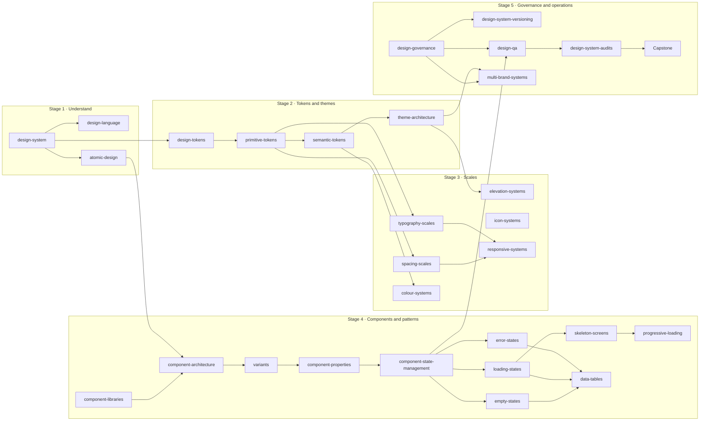

# Curriculum architecture — the Design Systems programme

> Phase 1 proposal, 2026-11-10. Builds on the existing `design-systems` learning path in `content/learning-paths.ts` (4 stages, 22 of the 29 domain topics) and proposes five stages that cover all 29. The path id stays `design-systems`; nothing in the taxonomy changes.

## Programme outcome

A learner who completes the path can explain, evaluate and build a small design system: define its principles and language, structure its tokens and themes, set its scales, specify components with states and patterns for real tasks, and run its governance, releases, QA and audits. They can defend each decision with principles, standards and trade-offs, and say when *not* to apply a practice.

## What changes from the current path

| Current path (4 stages) | Proposed (5 stages) | Reason |
|---|---|---|
| Stage 1 has `design-system`, `design-tokens` | Stage 1 = understand the system: `design-system`, `design-language`, `atomic-design` | Tokens need the system model first; atomic design is a composition mental model learners need before tokens and components. |
| Tokens, theme and scales mixed in Stage 2 | Stage 2 = tokens and themes; Stage 3 = scales | Scales consume tokens; splitting them keeps each stage to one kind of decision. |
| 7 topics missing from the path | All 29 placed | `elevation-systems`, `icon-systems`, `responsive-systems`, `data-tables`, `loading-states`, `skeleton-screens`, `progressive-loading` were absent. |
| `multi-brand-systems` in the last stage | Stays in Stage 5 | It depends on governance boundaries, not only on themes. The brief's starting model put it in Stage 2; the dependency check moved it. |
| No capstone | Stage 5 ends with the capstone mini design system | A cumulative deliverable is the strongest evidence of ability. |

## Dependency map

## Stage 1 — Understand design systems (beginner)

- **Purpose:** know what a design system is, what it is made of and what it is for.
- **Prerequisites:** `ui-design`, `visual-hierarchy` (published). No prior system knowledge.
- **Sequence:** `design-system` → `design-language` → `atomic-design`.
- **Learning outcomes:** distinguish a system from a style guide, UI kit and component library; trace a decision from principle to product; write a principle that rules something out; decompose a screen into composition levels and say where the model stops helping.
- **Visual explanation requirements:** existing design-system plate and architecture/contribution figures; a design-language figure (brand → language → foundations); an atomic-design composition tree.
- **Practice:** Architecture Explorer (L3, new); classify-the-artefact quiz; decompose a screen.
- **Completion criteria:** all three lessons read at beginner level; quiz at two levels; one decomposition exercise submitted.
- **Capstone contribution:** design-system brief and three principles.
- **Case study link:** `/system` overview and principles.

## Stage 2 — Tokens and theme architecture (beginner → intermediate)

- **Purpose:** record design decisions as tokens and build themes from them.
- **Prerequisites:** Stage 1; `colour-contrast-ratio` (published) for contrast checks.
- **Sequence:** `design-tokens` → `primitive-tokens` → `semantic-tokens` → `theme-architecture`.
- **Learning outcomes:** explain tokens and the DTCG format's status accurately; separate primitive values from semantic roles; map roles for two themes and prove contrast for every pair; specify a theme completeness check.
- **Visual requirements:** tier relationship figure (primitive → semantic → component), resolution-order process figure.
- **Practice:** Design Token Lab (L3, highest priority); Theme Playground (L3).
- **Completion:** token map for two themes with contrast proof.
- **Capstone contribution:** token structure and one complete theme.
- **Case study link:** `/system/foundations/colour`; UX Academy's own `tests/tokens.test.ts` as a working theme gate.

## Stage 3 — Scales and visual systems (intermediate)

- **Purpose:** turn foundations into scales that produce rhythm, hierarchy and adaptation.
- **Prerequisites:** Stage 2; `gestalt-principles`, `modular-type-scale` (published).
- **Sequence:** `spacing-scales` → `typography-scales` → `colour-systems` → `elevation-systems` → `icon-systems` → `responsive-systems`.
- **Learning outcomes:** choose and justify a spacing base and steps; define type roles that survive 200% zoom; build colour roles that never carry meaning alone; assign elevation levels with meaning; specify an icon set; specify reflow and target sizes for components.
- **Visual requirements:** a plate per topic; comparison figures for spacing, colour and elevation; a responsive process figure (this also fills the Responsive & Adaptive illustration category, D-109).
- **Practice:** Visual Scale Workshop, built from existing labs (`type-scale-lab`, `contrast-lab`, `colour-lab`, `cvd-lab`, `responsive-lab`) plus a spacing and elevation module.
- **Completion:** one scale specification per topic, reviewed against the checklist.
- **Capstone contribution:** foundations sheet (spacing, type, colour, elevation, icons, responsive rules).
- **Case study links:** `/system/foundations/*` (colour, typography, spacing-layout, shape-elevation, iconography).

## Stage 4 — Components and patterns (intermediate → advanced)

- **Purpose:** specify components as contracts and compose them into patterns for real tasks.
- **Prerequisites:** Stages 2–3; `affordances`, `signifiers`, `wcag` (published); `interaction-states` (planned, linked as context).
- **Sequence:** `component-libraries` → `component-architecture` → `variants` → `component-properties` → `component-state-management` → `empty-states` → `loading-states` → `skeleton-screens` → `progressive-loading` → `error-states` → `data-tables`.
- **Learning outcomes:** decide whether a new component is needed; write an anatomy, variants, properties and a full state matrix with keyboard and announcement behaviour; choose the right empty, loading and error pattern for a context; design an accessible data table and know when a table is the wrong choice.
- **Visual requirements:** anatomy and state-machine figures; decision trees for empty and loading states; table anatomy.
- **Practice:** Component Specification Workshop (extends the existing `accessible-component` workshop); Component State Playground (L3); Pattern Composition Workshop.
- **Completion:** one complete component specification and one pattern solving a task, both reviewed.
- **Capstone contribution:** component library of at least three components and two patterns.
- **Case study links:** `/system/components/button`, `field`, `table`, `progress`, `dialog`; `/system/patterns/empty-states`, `filter-and-search`.

## Stage 5 — Governance and operations (advanced)

- **Purpose:** keep a system useful and trusted as it grows across teams and brands.
- **Prerequisites:** Stage 4.
- **Sequence:** `design-governance` → `design-system-versioning` → `design-qa` → `design-system-audits` → `multi-brand-systems` → capstone.
- **Learning outcomes:** write contribution criteria and decision rights; classify and communicate changes; define acceptance criteria and a QA plan covering accessibility, themes and widths; run an audit with dated evidence and prioritised actions; design a shared core with brand layers.
- **Visual requirements:** contribution process (existing figure), release timeline, audit hierarchy, brand-layer relationship.
- **Practice:** governance scenarios; release-note exercise; Design System Audit Simulator (L3); Theme Playground in brand mode.
- **Completion:** governance proposal, QA checklist and audit report; capstone submitted.
- **Capstone:** the mini design system (see PRACTICE_AND_INTERACTION_PLAN.md §9).

## Beginner → advanced progression within each lesson

Each entry keeps the Academy's three levels (see TOPIC_LESSON_SPECIFICATION.md). Across the path, the dominant level rises by stage: Stages 1–2 lead with beginner explanations, Stages 3–4 with intermediate application, Stage 5 with advanced evaluation. Every lesson still offers all three levels.

## Related Academy content to link, not duplicate

| Existing topic | Status | Used by |
|---|---|---|
| `modular-type-scale` | published | typography-scales (the calculation lives there) |
| `colour-contrast-ratio` | published | semantic-tokens, colour-systems, theme-architecture |
| `gestalt-principles`, `visual-hierarchy` | published | spacing-scales, design-language |
| `wcag`, `accessibility-concept` | published | every component and pattern lesson |
| `doherty-threshold` | published | loading-states |
| `interaction-states`, `state-transitions` | planned | component-state-management |
| `error-prevention`, `error-recovery`, `error-messages` | planned | error-states |
| `iconography` | planned | icon-systems |
| `responsive-breakpoints`, `responsive-composition`, `responsive-development`, `grid-systems` | planned | responsive-systems, spacing-scales |
| `design-to-development-handoff` | planned | component-architecture, component-properties, design-qa |
| `design-critique` | planned | design-qa |

## Proposed path record (for Phase 2, not applied)

Five stages with the sequences above; `practice` per stage: Stage 1 none yet (Architecture Explorer when built), Stage 2 Token Lab, Stage 3 `type-scale-lab` plus `contrast-lab`, Stage 4 `accessible-component`, Stage 5 Audit Simulator. `completion`: capstone submitted, plus the existing two items. The path change is a content edit to `content/learning-paths.ts` with tests; it is listed in IMPLEMENTATION_ROADMAP.md.
